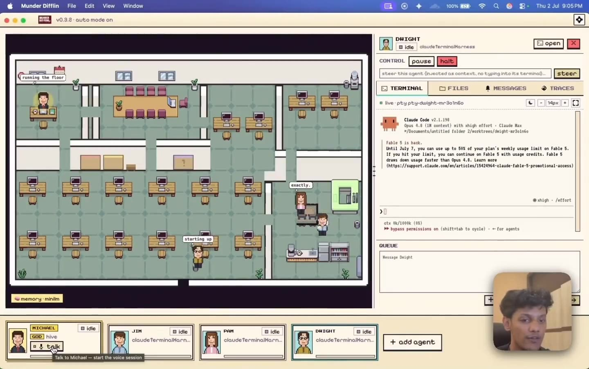
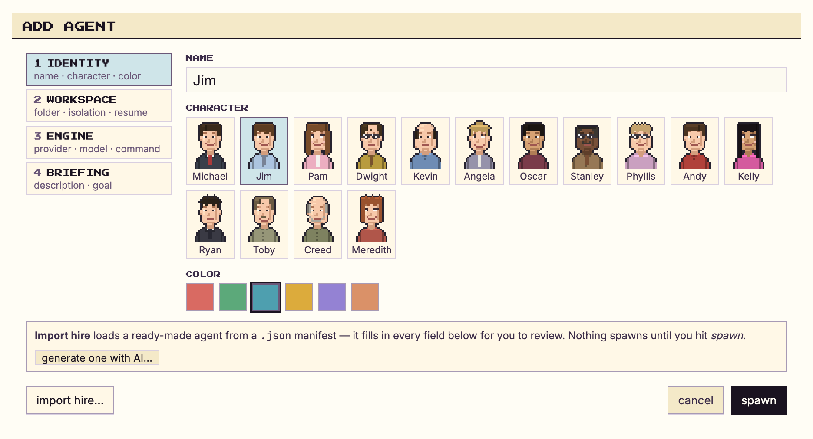
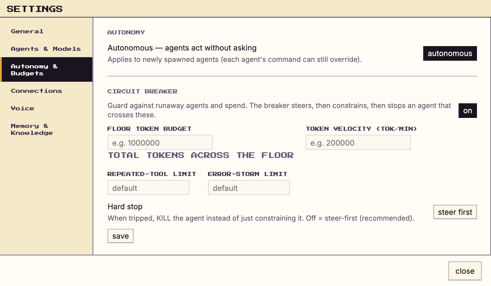

<div align="center">


# AgFlow

### 本地运行的多智能体编排桌面工具


**开源免费 · 本地运行 · 国产引擎优先。** AgFlow 把你终端里已经在用的 AI CLI 组装成一支自动分工、共享记忆的智能体团队——总控「败龙」负责分派任务、路由消息，每个智能体以角色形象在办公楼层上并行工作。

<p>
  <em>Electron · React · TypeScript · Pixi.js · xterm.js · node-pty</em>
</p>

<p>
  <a href="./LICENSE"></a>
  <a href="./CHANGELOG.md"></a>
  
  <a href="./CONTRIBUTING.md"></a>
</p>

<br>

<!-- GitHub 页内播放需要绝对地址（相对路径只能变成普通链接）。 -->
<video src="https://github.com/Byron569/AgFlow/raw/main/docs/media/hero.mp4" controls muted loop playsinline width="820">
  <a href="https://github.com/Byron569/AgFlow/raw/main/docs/media/hero.mp4">▶ 观看办公楼层实况</a>
</video>

</div>

---

> [!NOTE]
> **把终端里的智能体 CLI，变成你的一间办公室。**
> AgFlow 接管你已经在用的 CLI（`claude`、`agy`、`codex`、`opencode`、`kimi`、
> `qwen`、`zcode`、`traecli` 等），给每个智能体一份长期记忆、一个邮箱和一个工位，
> 由**总控「败龙」**在它们之间分派任务、路由消息。它是楼层的管家；
> 你，仍然是它的老板。

## 目录

- [支持的引擎](#支持的引擎)
- [这是什么](#这是什么)
- [工作原理](#工作原理)
- [功能](#功能)
- [快速开始](#快速开始)
- [架构与项目结构](./docs/ARCHITECTURE.md)
- [路线图](#路线图)
- [参与贡献](#参与贡献)
- [遥测](#遥测)
- [许可证](#许可证)
- [致谢](#致谢)

## 支持的引擎

**直接带上你已经在用的 CLI。** 每个引擎都以真实进程运行在独立终端里，沿用你现有的订阅与配额。能跑在终端里的，就能跑在这里。

**国产引擎**

<p>
  <kbd>豆包 · 火山方舟</kbd>
  <kbd>DeepSeek</kbd>
  <kbd>GLM · 智谱</kbd>
  <kbd>Ollama · 本地模型</kbd>
  <a href="https://www.kimi.com/code"><kbd>Kimi Code</kbd></a>
  <a href="https://github.com/QwenLM/qwen-code"><kbd>Qwen · 通义</kbd></a>
  <kbd>Trae · 字节（traecli）</kbd>
  <kbd>CodeBuddy · 腾讯</kbd>
  <kbd>ZCode · 智谱</kbd>
</p>

**国际引擎**

<p>
  <a href="https://claude.com/claude-code"><kbd>Claude Code</kbd></a>
  <a href="https://github.com/openai/codex"><kbd>Codex · GPT</kbd></a>
  <a href="https://x.ai/cli"><kbd>Grok · xAI</kbd></a>
  <a href="https://github.com/google-gemini/gemini-cli"><kbd>Gemini CLI</kbd></a>
  <a href="https://antigravity.google/docs/cli-overview"><kbd>Antigravity · Gemini</kbd></a>
  <a href="https://opencode.ai/docs"><kbd>OpenCode</kbd></a>
  <a href="https://github.com/charmbracelet/crush"><kbd>Crush · Charm</kbd></a>
  <a href="https://pi.dev/docs/latest"><kbd>Pi</kbd></a>
  <a href="https://docs.github.com/copilot/concepts/agents/about-copilot-cli"><kbd>GitHub Copilot</kbd></a>
  <a href="https://cursor.com/docs/cli/install"><kbd>Cursor</kbd></a>
  <kbd>+ 任意自定义命令</kbd>
</p>

国产引擎中的**豆包、DeepSeek、GLM、Ollama** 走内置的 OpenCode 壳一体化接入（在设置里填端点与密钥即可，本地 Ollama 免密钥）；其余引擎直接运行各自的 CLI。另支持 **BYOK 密钥**与 **Ollama / LM Studio / vLLM 本地端点**。

## 这是什么

AgFlow 是一个桌面应用：把**真实的终端智能体 CLI** 包装成完整能力的智能体，接入一个**蜂巢**，并让**「败龙」**替你管理它们。败龙是唯一需要你直接对话的智能体；它底下跑着一套毫秒级召回的**记忆层**，让每个智能体记住学到的东西、随取随用。

- **每个终端都是智能体。** 每一个 `claude`、`agy`、`codex`、`opencode`、`zcode` 或自定义会话，都作为真实进程运行在伪终端（`node-pty`）里，xterm.js 渲染，字节级真实。
- **每个智能体都是角色。** 会话以角色出现在 Pixi.js 办公楼层上：工作时走向工位，互相发消息时信封在桌位之间飞递。
- **蜂巢负责协调。** 智能体读取自己的记忆、收取邮箱；路由器在收件箱之间搬运消息；总控负责裁决、分派，只在真正需要你时上报。
- **记忆即时可得。** markdown 优先的记忆层 + 语义召回索引：跨会话记住，毫秒级召回。

## 工作原理

```
           你 ──对话──► ┌───────────────┐
                        │   总控「败龙」 │ 编排 / 监督
                        │   （总控台）   │ 名册 · 路由 · 裁决
                        └───────┬───────┘
                                │ 分派 · 路由 · 上报
          ┌─────────────────────┼─────────────────────┐
          ▼                     ▼                     ▼
     ┌───────────┐         ┌───────────┐         ┌───────────┐
     │  智能体 A  │  消息   │  智能体 B  │  消息   │  智能体 C  │
     │  引擎+记忆 │ ──────► │  引擎+记忆 │ ──────► │  引擎+记忆 │
     └───────────┘         └───────────┘         └───────────┘
          └────── 共享蜂巢：记忆 · 邮箱 · 黑板 · 事件日志 ──────┘
```

1. **你拉起智能体**：每一个都是普通终端进程（`claude`、`agy`、`codex` 或自定义命令），有自己的工作目录、身份与提供商特定的生命周期。
2. **智能体通过蜂巢协作**：蜂巢是一个由纯文本文件组成的本地 git 仓库。智能体写入自己的 `outbox/`，路由把消息投递进收件人的 `inbox/`。智能体从不直接触碰 git（单提交者设计，避免 `index.lock` 损坏）。
3. **总控「败龙」管理楼层**：它读取每个请求，自行解决常规事项（保持系统全自动运行），只把*关键*事项（花费、破坏性操作、范围变更）升级到审批队列等你的决定。
4. **一切可见**：你可以看角色走动、信封飞递与实时终端流；也可以往任意会话里打字、浏览它的文件、读它的 git 历史。

完整的多智能体设计见 [`HIVE.md`](./HIVE.md)，终端 / 事件面规格见 [`SPEC.md`](./SPEC.md)，视觉系统见 [`DESIGN.md`](./DESIGN.md)。

## 功能

<table>
<tr>
<td width="50%" valign="middle">

### 只和一个智能体说话

败龙是你的总管，也是唯一需要交代事情的智能体。它分派工作、路由流量，只把少数真正需要你的事上报。

</td>
<td width="50%">
  <a href="https://github.com/Byron569/AgFlow/raw/main/docs/media/demo/orchestrator.mp4"></a>
</td>
</tr>
<tr>
<td width="50%" valign="middle">

### 几点击雇一个智能体

选 CLI、选模型、定自主级别，给它一个工位，它就开始工作。也可以从内置的**中文职位模板库**一键预填（导入只预填表单，仍需你确认才会拉起）。

</td>
<td width="50%">
  
</td>
</tr>
<tr>
<td width="50%" valign="middle">

### 记忆跨会话存活

每个智能体都保留 markdown 记忆，汇入共享的记忆宫可搜索。关掉应用，明天回来，它们依然记得学到的东西。

</td>
<td width="50%">
  
</td>
</tr>
<tr>
<td width="50%" valign="middle">

### 有缰绳的自主

给每个智能体设定自主边界。花费、范围与破坏性操作会回到你这里，熔断器则对死循环或失控的智能体先引导、再约束、最后停止。

</td>
<td width="50%">
  
</td>
</tr>
<tr>
<td width="50%" valign="middle">

### 看整层楼运转

智能体工作时走向工位，互相发消息时信封在桌位间飞递。点任意工位即可实时查看该终端，并直接打字回去。

</td>
<td width="50%">
  <a href="https://github.com/Byron569/AgFlow/raw/main/docs/media/demo/agents.mp4"></a>
</td>
</tr>
<tr>
<td width="50%" valign="middle">

### 一次性配置

引导向导会检查你机器上已有的工具，缺什么就直接给出安装入口，而不是把你丢到文档页。

</td>
<td width="50%">
  <a href="https://github.com/Byron569/AgFlow/raw/main/docs/media/demo/setup.mp4"></a>
</td>
</tr>
</table>

**楼层**
- **每个终端都是真实智能体。** Claude Code、Codex、OpenCode、Kimi、Qwen、ZCode 或自定义命令，各自运行在独立 `node-pty` 伪终端中，xterm.js 渲染。
- **每个智能体都是角色。** Pixi.js 办公楼层：智能体走向工位、信封在桌位间飞递，角色状态反映真实工作进度。
- **一个可以直接对话的总控。** 「败龙」负责任务路由、流量裁决，只把需要人的事项上报。也可以按 **Talk** 用语音指挥楼层。
- **每智能体 git worktree。** 可选的文件隔离，让并行智能体不会互相冲突。
- **多楼层。** 文件 → 新建楼层：另一个办公室在独立窗口中运行自己的智能体、看板与记忆。

**记忆与协作**
- **蜂巢**：每智能体记忆、原子文件邮箱、共享黑板、追加式事件日志、单提交者 git。
- **语义召回**：markdown 记忆汇入共享记忆宫，界面内可搜，带压缩以防无限增长。
- **企业知识图谱**：你自己的文档与策略，任何智能体都可查询。

**控制与安全**
- **人工闸门**：花费、范围与破坏性操作上报给你；可中途干预，或优雅停止。
- **熔断器**：steer → constrain → stop 三级阶梯，处理死循环、错误风暴与超预算的智能体。
- **预算与遥测**：每智能体 token 预算、来自会话记录的真实成本、持久台账、OTel 跨度与工具瀑布图——全部本地采集，不出境。

**总控台**
- **带键任务**：每张任务卡有类似 `V53-299` 的键；每个智能体有「任务」页签；任务屏可按时间筛选。
- 看板任务（带依赖）、定时任务 + 心跳、实时舰队监控、记忆搜索、活动日志与 CI 监测。
- **技能**：智能体现在就会什么，加上可浏览的技能库（搜索、安装、卸载）。
- **内置 Monaco IDE**：文件树、编辑器页签、保存，以及 CHANGES · HISTORY · COMPARE 三条 git 轨道（提交图、diff、分支对比、受保护的检出）。所有文件系统 / git 访问都经主进程代理。

**把工作送进送出**
- **Slack 与 webhook**：给频道发消息或 POST webhook；「败龙」可以拉起临时工人、在会话内回复、然后销毁。
- **可分享的 hire**：用 `agflow://hire` 链接导入职位；导入只预填表单，仍需人工确认才会拉起。
- **本地听写与会议转写**：任意应用内听写；会议转写区分「你」与「对方」，模型本地运行、不出境（内置 Whisper 模型，当前识别语言为英文）。
- **BYOK 密钥 + 本地模型**：各提供商密钥存于只写密钥代理，支持 Ollama / LM Studio / vLLM 端点。
- **便携模式**：数据目录可重定向到 U 盘或自定义路径，引擎与数据一起随行。
- **界面语言**：默认简体中文。
- **环境自检**：设置页列出支撑工具（git、Node、各个智能体 CLI 等）的安装状态，缺什么一键补装。

<div align="right">(<a href="#agflow">↑ 回到顶部</a>)</div>

## 快速开始

### 环境要求

- **macOS、Windows 或 Linux**
- **Node.js 18+** 与 npm
- `node-pty` 原生模块需要 C/C++ 工具链；macOS 上安装 Xcode Command Line Tools：

  ```bash
  xcode-select --install
  ```

- `PATH` 中至少一个受支持的引擎 CLI（见上方列表）。多数缺失的 CLI 可以自愈：应用会在终端里运行安装命令，并继续使用新装的二进制。
- *可选：* 在 **设置 → AI 引擎** 中填入你自己的 API 密钥与本地模型端点（Ollama / LM Studio / vLLM）。
- *可选：* 语义记忆索引（跨会话即时召回）。没有它，markdown 记忆照样工作。

### 从源码运行

```bash
git clone https://github.com/Byron569/AgFlow.git
cd AgFlow
npm install        # postinstall 会针对 Electron ABI 重建 node-pty
npm run dev        # 启动 Electron 应用（热更新）
```

首次启动会走一遍引导向导，然后落在办公楼层。用「添加智能体」创建第一个会话；总控「败龙」会自动入座自己的办公室。

### 其他脚本

```bash
npm run build         # electron-vite 生产构建
npm run preview       # 预览生产构建
npm run typecheck     # 类型检查（node / web 两个项目）
npm run test:focused  # 单元测试
npm run dist          # 构建并打包安装包（electron-builder）
```

> 如果升级 Electron 后 `node-pty` 加载失败，重新跑 `npm install`（`postinstall` 会针对当前 Electron ABI 执行 `electron-rebuild`）。

## 架构

两条数据面汇聚到一个渲染层：**终端面**掌管 PTY、文件系统与 git，**事件面**运行蜂巢、hook 服务器与路由器；渲染层只通过类型化的桥接与两者通信。

完整的图表、逐模块项目结构与设计系统见 [`docs/ARCHITECTURE.md`](./docs/ARCHITECTURE.md)；多智能体设计见 [`HIVE.md`](./HIVE.md)，终端与事件面规格见 [`SPEC.md`](./SPEC.md)，视觉系统见 [`DESIGN.md`](./DESIGN.md)。

<div align="right">(<a href="#agflow">↑ 回到顶部</a>)</div>

## 路线图

本仓库基于上游 0.5.3 完成了一轮国产化二创，已交付：

- **全站中文化**：默认简体中文界面，提示词、技能与硬编码文案全面清理
- **品牌替换与去遥测**：全站品牌统一为 AgFlow，移除遥测上报（PostHog）
- **国产引擎接入**：豆包 · 火山方舟、DeepSeek、GLM · 智谱、Ollama 一体化接入（OpenCode 壳 + 端点 / 密钥注入），Kimi / Qwen / Trae / CodeBuddy / ZCode 适配
- **败龙与角色体系**：总控默认「败龙」，配套中文职位角色模板库与历史名称迁移工具
- **便携模式**：数据目录三档重定向（环境变量 / 便携标记 / 默认），引擎随行目录

接下来：

- [ ] 更多国产 CLI 的真机适配与技能投放
- [ ] 技能包扩充与集成模板
- [ ] 更多聊天集成（把频道消息接进败龙的队列并路由回复）

完整历史见 [`CHANGELOG.md`](./CHANGELOG.md)。

<div align="right">(<a href="#agflow">↑ 回到顶部</a>)</div>

## 参与贡献

欢迎贡献。这是预发布软件，改动面很大——先读 [`CONTRIBUTING.md`](./CONTRIBUTING.md)。简版：fork → `npm install && npm run dev` → 保持 `npm run typecheck` 绿色 → 新增 UI 必须从 [`DESIGN.md`](./DESIGN.md) 的设计令牌派生。

> [!IMPORTANT]
> **每个 PR 必须给出改动前与改动后的证据**：截图；会动的东西用录屏。没有证据的 PR 不会被合并。

## 遥测

AgFlow 不收集、不发送任何遥测数据。使用事件、提示词、代码、文件路径与智能体输出，都不会离开你的机器。

## 许可证

> [!IMPORTANT]
> **素材许可。** 内置像素素材（tileset 与地图）来自 [LimeZu](https://limezu.itch.io/moderninteriors) 的 **Modern Interiors - RPG Tileset [16X16]**，按 **Complete Version** 许可使用：允许修改并用于商业 / 非商业项目，**署名必须保留**。Office 角色形象不是 LimeZu 素材，由 `portraitArt.ts` 程序化绘制。见 [`src/renderer/src/assets/ATTRIBUTION.md`](./src/renderer/src/assets/ATTRIBUTION.md)。

**源代码**采用 **MIT 许可**，见 [`LICENSE`](./LICENSE)。MIT 授权只覆盖代码；内置像素素材单独许可，见 [`LICENSE-ASSETS`](./LICENSE-ASSETS)。

## 致谢

- [LimeZu](https://limezu.itch.io/) — *Modern Interiors* 像素素材（Complete Version 许可）
- [`shahar061/the-office`](https://github.com/shahar061/the-office) — 办公室 tileset / 地图来源
- [Pixi.js](https://pixijs.com/) · [xterm.js](https://xtermjs.org/) · [node-pty](https://github.com/microsoft/node-pty) · [electron-vite](https://electron-vite.org/) · [CodeMirror](https://codemirror.net/) — 本项目所依赖的库
- [Remotion](https://www.remotion.dev/) — 落地页动画片段（`landing-remotion/`）